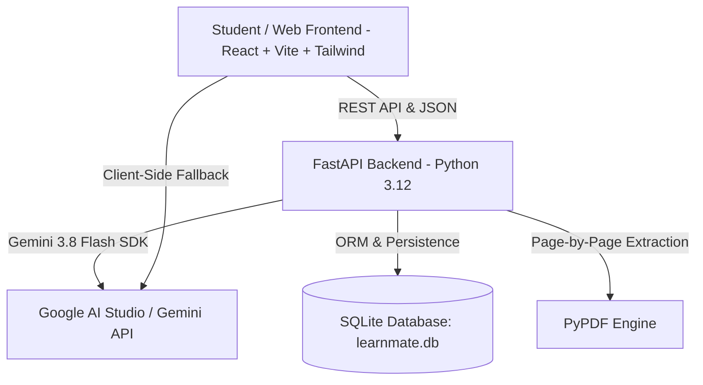

# 🚀 LearnMate: Teammate Backend & Antigravity Collaboration Guide

Welcome team! LearnMate is an award-winning personalized AI learning companion designed for the Google AI Hackathon.
This guide shows how any teammate can work on the backend, run it, and use **Google Antigravity** to add new features seamlessly.

---

## 🏗️ Architecture Overview



- **Frontend**: Vite + React 19 + TypeScript + Tailwind CSS. Supports 3 interchangeable connection modes:
  1. **FastAPI Backend Mode** (Full persistence + server processing)
  2. **Direct Gemini Mode** (Runs directly against Google AI Studio using `@google/genai`)
  3. **Offline Demo Mode** (Instant pre-computed high-yield responses for reliable judge demonstrations)
- **Backend**: FastAPI, `google-genai` (v2.25+ official SDK), `pypdf`, SQLite3.
- **Model**: `gemini-3.8-flash` (1M context window, high reasoning speed, multimodal).

---

## ⚡ 1. Quick Start for Backend (2 Minutes)

### Step 1: Open Terminal in Project Root
```bash
cd backend
```

### Step 2: Create and Activate Virtual Environment
```bash
# Windows
python -m venv venv
.\venv\Scripts\activate

# macOS / Linux
python3 -m venv venv
source venv/bin/activate
```

### Step 3: Install Dependencies
```bash
pip install -r requirements.txt
```

### Step 4: Configure Environment Variables
Copy `.env.example` to `.env`:
```bash
cp .env.example .env
```
Open `.env` and add your Gemini API Key from [Google AI Studio](https://aistudio.google.com/):
```env
GEMINI_API_KEY=AIzaSy...your_key_here
PORT=8000
```

### Step 5: Launch Backend
```bash
python run.py
```
- API will be live at: `http://localhost:8000`
- Interactive Swagger UI: `http://localhost:8000/docs`

---

## 🤖 2. How to Use Google Antigravity to Build & Extend the Backend

Antigravity is your AI pair programmer. Any teammate can open this project in Antigravity and prompt it to implement new backend capabilities. Here are exact prompt recipes to give Antigravity:

### Prompt Recipe 1: "Add User Authentication with JWT"
> *"Antigravity, please add user authentication to the LearnMate FastAPI backend in `backend/` using JWT tokens and bcrypt password hashing. Create a new `users` table in `database.py`, add `/api/auth/register` and `/api/auth/login` in `main.py`, and protect the quiz attempt and revision plan endpoints so each student has their own learning journey."*

### Prompt Recipe 2: "Add Multimodal Image & Diagram Understanding"
> *"Antigravity, update `gemini_service.py` and `main.py` to accept uploaded diagrams or textbook photos alongside PDFs. Use Gemini 3.8 Flash's multimodal vision capability to explain charts, biochemical diagrams, and graphs with page and coordinate references."*

### Prompt Recipe 3: "Scale to Vector Search (RAG) for 100+ Page Textbooks"
> *"Antigravity, using `gemini-embedding-2` from the `google-genai` SDK, build a semantic chunking and RAG pipeline in `backend/rag_service.py` using ChromaDB or FAISS. When a student uploads a large textbook (>20 pages), index the chunks and retrieve the most relevant passages before calling `explain_concept` or `answer_grounded_question`."*

### Prompt Recipe 4: "Deploy Backend to Google Cloud Run"
> *"Antigravity, generate a production-ready `Dockerfile`, `.dockerignore`, and a `cloudbuild.yaml` script to build and deploy our FastAPI backend to Google Cloud Run with one gcloud command, passing `GEMINI_API_KEY` from Google Secret Manager."*

---

## 📡 3. REST API Specification

| Method | Endpoint | Description |
|---|---|---|
| `POST` | `/api/upload-pdf` | Accepts multipart PDF file, extracts page numbers and text, returns `material_id`. |
| `POST` | `/api/upload-text` | Accepts raw text or pasted chapter, paginates text, returns `material_id`. |
| `POST` | `/api/explain` | Returns grounded concept breakdown, simple analogies, citations, and Hindi translation toggle. |
| `POST` | `/api/quiz/generate` | Generates 5 high-yield MCQs with specific page references. |
| `POST` | `/api/quiz/evaluate` | Evaluates student answers, identifies misconceptions, updates weak topics list. |
| `POST` | `/api/revision-plan` | Creates 3-day spaced revision plan + 3 follow-up targeted practice questions. |
| `POST` | `/api/audio-summary` | Generates conversational 2-minute NotebookLM-style podcast dialogue. |
| `POST` | `/api/chat` | Grounded Q&A. If answer is not in material, sets `is_out_of_scope: true`. |
| `GET` | `/api/progress/{id}` | Returns attempt history, score progression, and mastery trends across attempts. |

---

## 🏆 Hackathon Winning Edge Checklist
- [x] Grounded Citations (Every explanation & question cites page/passage)
- [x] Out-of-Scope Detection (Flags questions not in material)
- [x] Hindi / Hinglish translation & audio toggle
- [x] Spoken podcast revision summaries (NotebookLM style)
- [x] Weakness radar & dynamic 3-day revision plan
- [x] Multi-attempt tracking with persistent SQLite storage
